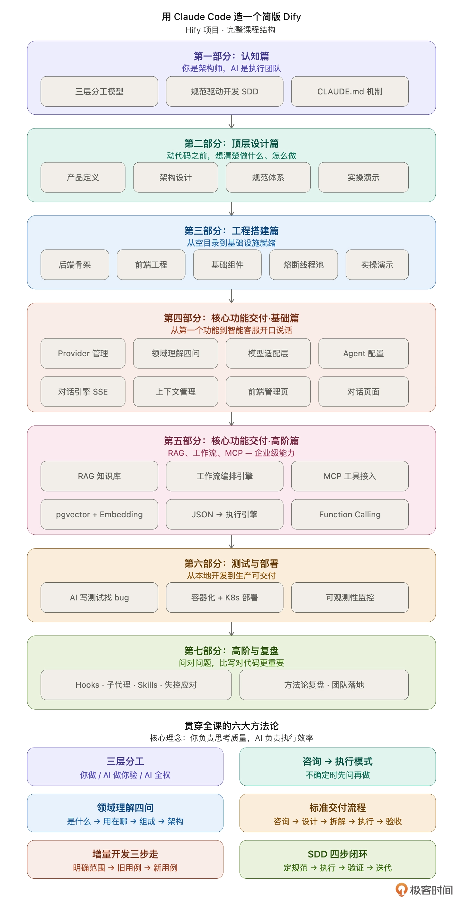
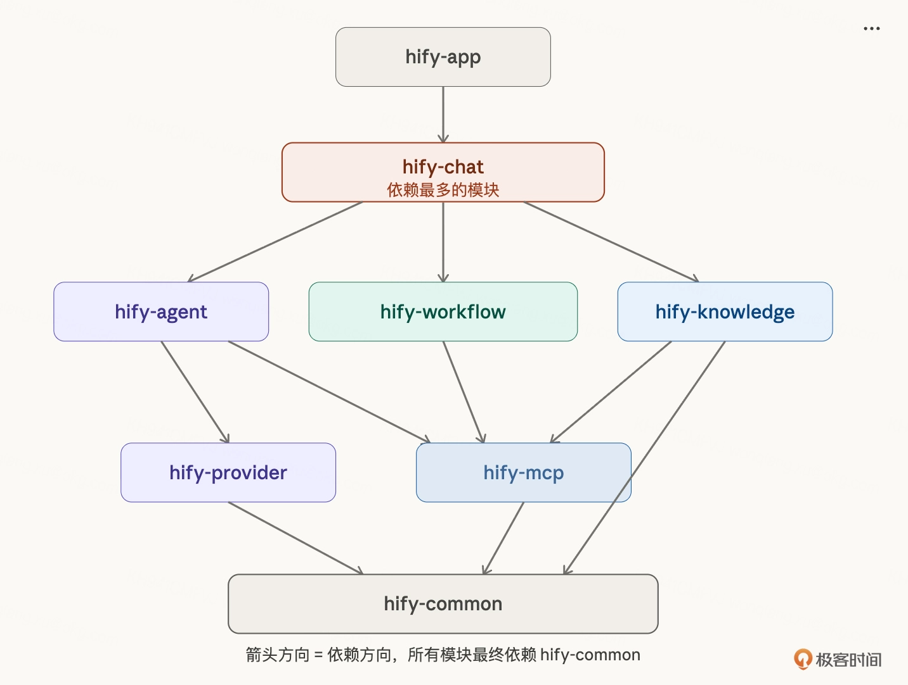
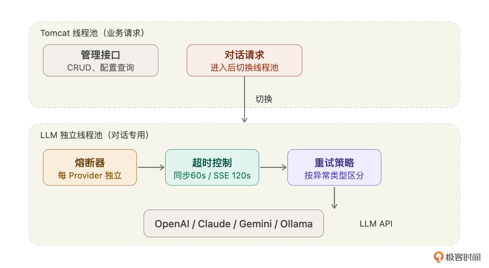
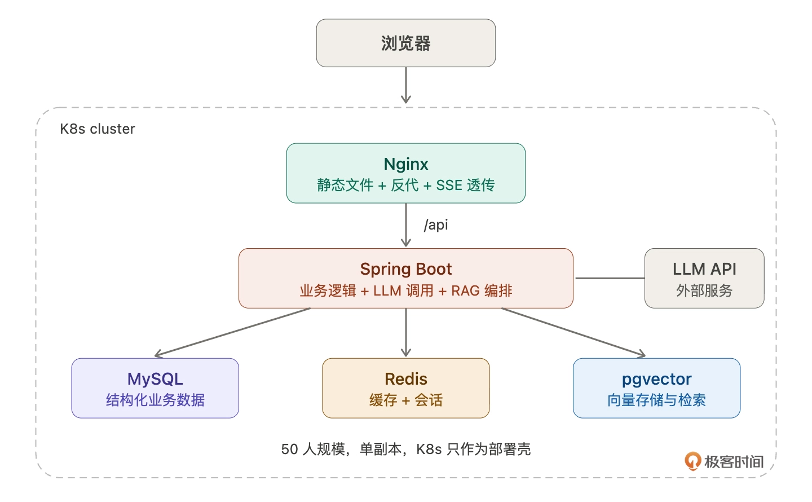
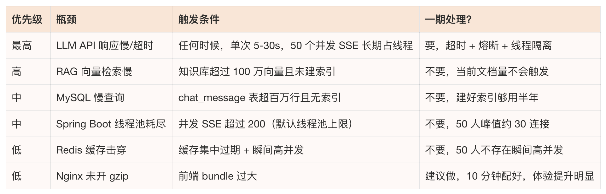
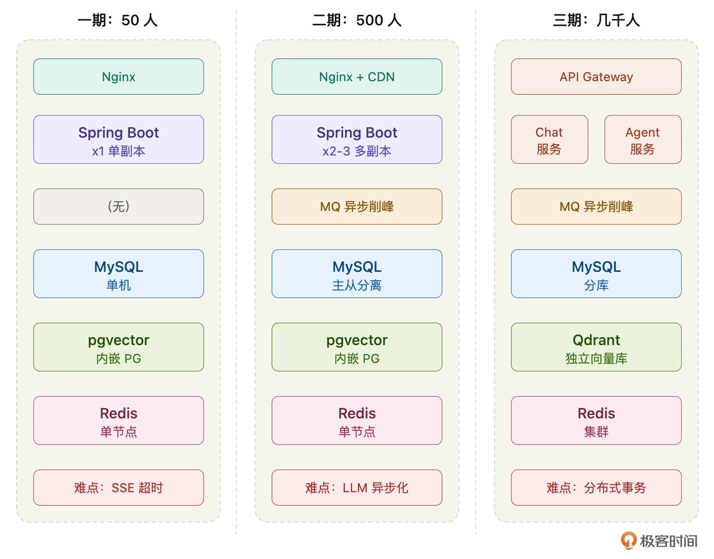
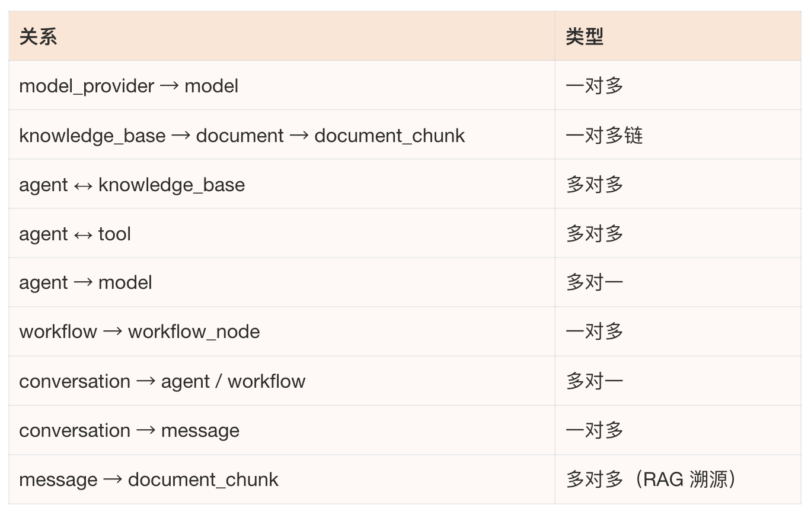
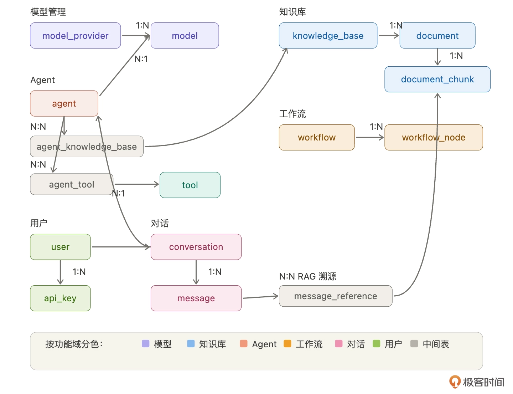
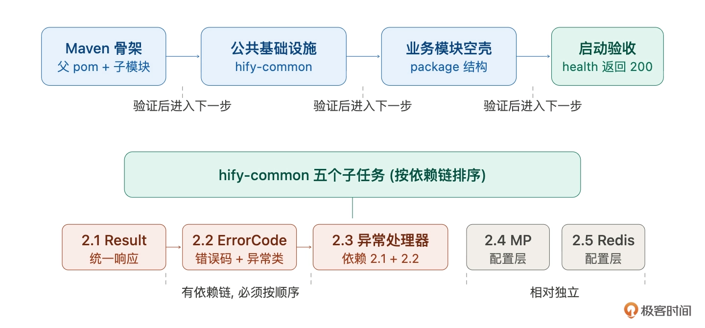
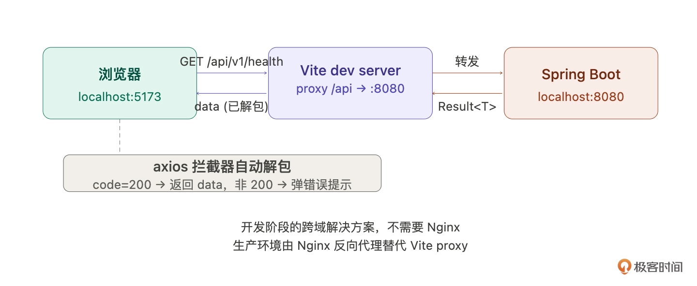

# 课程大纲



# 认知篇

## 人机分工

### 分工

1. 第一层，必须你做的。产品边界、架构决策、技术取舍、跨模块一致性。
2. 第二层，AI 做你验收的。业务代码、接口开发、前端页面、测试用例、文档。有一个硬标准：任何一行代码你都要能说清楚它在干什么。说不清楚，就不能用。
3. 第三层，AI 全权处理的。格式化、样板代码、简单重构、启动脚本、Makefile。扫一眼没问题就行。

### 验收

1. 第一步，查意图：它做的是不是你让它做的？功能多了，需要砍掉或确认后再保留。
2. 第二步，查质量：项目风格、规范、一致性
3. 第三步，查边界：错误处理、异常、潜在风险

## SDD 开发范式

### 第一步：定规范

在写任何业务代码之前，先把基础规范定下来。第一版粗一点没关系，但一定要有。

关键是覆盖 Claude 最容易跑偏的地方。

1. 命名风格
2. 返回格式
3. 错误码体系
4. 设计原则

### 第二步：AI 按规范执行

下达任务时，明确引用规范。

### 第三步：人验证输出

三步检查法，意图、质量、边界，检查 Claude 的输出是否符合规范。

### 第四步：迭代规范

在验证输出时，一定会发现规范没覆盖到的地方。每次发现缺口，都要补上。

## 规范分层

1. 全局规范。写在 CLAUDE.md 里，整个项目通用，这是地基。命名规则、接口格式、错误码体系、设计原则、行为约束。项目初期定好，后面很少改动。
2. 模块规范。某个模块开发前单独定义。
3. 任务规范。每次给 Claude 下达具体任务时的补充说明。临时性的，不落成文档。

## 规范编写

### 具体不模糊

判断标准：Claude 看到这条规范后，是否还需要“猜”你的意思？如果还需要猜，就不够具体。

### 有优先级不贪多

原则：AI 反复跑偏的地方写细，不跑偏的地方不写。

规范不是越多越好。因为上下文窗口是有限的，塞了太多反而会稀释重要的那几条。

### 规则带上原因背景

涉及工程权衡的规范，不能只告诉 Claude “不要这样做”，还要告诉它为什么。它需要理解约束的原因，才能在类似场景中举一反三。

# 顶层设计

## 产品定义

### 流程拆解

调研标杆（Claude 梳理 Dify 功能全景）→ 功能取舍（三问裁剪法，Claude 做初筛你拍板）→ 技术选型（Claude 做方案对比，你基于约束选择）→ 运维预期（Claude 帮你查漏补缺）→ 落成文字（写进 CLAUDE.md）。

### 功能取舍

三问剪裁法：

1. 第一问：没有它产品还成立吗？区分核心和边缘。模型管理、Agent 配置、对话引擎、工具集成、管理控制台，这五个砍掉任何一个产品都不成立。知识库和工作流砍掉产品能用但价值大打折扣，降级做。可视化拖拽、多租户、插件市场、计费，砍掉不影响核心链路。

2. 第二问：做到什么程度够用？核心功能不做满。模型管理只做 CRUD + 连通性测试。Agent 配置只做选模型、绑工具、设提示词。对话引擎只做流式 + 多轮。知识库只支持 TXT + 固定分块。工作流只支持 JSON 配置。管理控制台能用就行不追求精美。

3. 第三问：能不能一句话说清楚？Hify：一个可本地部署的 AI Agent 开发平台，支持多模型管理、Agent 配置、知识库 RAG、简版工作流、对话交互和 MCP 工具接入，面向团队内部小规模使用。

### 技术选型

- 后端：Spring Boot 3.x + MyBatis-Plus + MySQL 8.x + Redis 7.x
- 前端：Vue 3 + TypeScript + Vite + Element Plus
- 容器化：Docker + Docker Compose

### 运维预期

- Docker Compose 本地一键部署，JVM 内存设上限（-Xmx512m）
- 目标：20-50 人同时在线，峰值 3-5 QPS，瓶颈在 LLM 长连接
- 缓存：Redis Cache-Aside（配置信息 + 会话上下文）
- 监控：起步 Actuator + 日志，后期 Prometheus + Grafana

### 产品矩阵


## 架构设计

### 应用架构：模块化单体

分层规则：

- Controller 只做参数校验和调用 Service，不写业务逻辑
- Service 处理所有业务逻辑，包括事务管理
- 跨模块调用走 Service 接口，不直接引用其他模块的 Mapper 或 Entity
- Entity 不直接返回给前端，用 DTO 做转换

```
hify/
├── hify-app/                # 启动模块，Spring Boot Application
├── hify-provider/           # 模型提供商管理
├── hify-agent/              # Agent 管理与配置
├── hify-chat/               # 对话引擎
├── hify-mcp/                # MCP 工具管理与调用
├── hify-workflow/           # 工作流编排与执行
├── hify-knowledge/          # 知识库与 RAG
├── hify-common/             # 公共模块（工具类、常量、异常、DTO）
├── hify-web/                # Vue 前端
└── deploy/                  # Docker Compose 配置
```



### 代码组织规范

```
src/main/java/com/hify/{module}/
├── controller/        # REST 接口
├── service/           # 业务逻辑接口
├── service/impl/      # 业务逻辑实现
├── mapper/            # MyBatis-Plus Mapper
├── entity/            # 数据库实体
├── dto/               # 请求/响应对象
├── config/            # 配置类
├── exception/         # 模块级自定义异常
└── constant/          # 模块级常量
```

每一层的职责边界：

- Controller 只做两件事：参数校验和调用 Service。不写业务逻辑、不做数据查询、不处理事务。
- Service 处理所有业务逻辑，包括事务管理、数据校验、业务规则。Service 之间可以互相调用，但只能调接口，不能直接 new 实现类。
- Mapper 只做数据库操作。不要在 Mapper 的 XML 里写业务逻辑（比如复杂的条件判断），那是 Service 的事。
- Entity 和数据库表一一对应。DTO 是给接口用的请求/响应对象。Entity 和 DTO 之间要做转换，不要把 Entity 直接返回给前端——Entity 里可能有敏感字段（API Key），DTO 可以控制暴露哪些字段。

### 外部调用设计

LLM API 调用三个特点：慢（一次对话 3-30 秒）、不稳定（随时可能超时、限流、报错）、多供应商（每家行为不一样）。不提前设计好，上线就炸。

- 线程池隔离：LLM 调用使用独立线程池，和业务请求隔离
- 熔断机制：Resilience4j 熔断，每个提供商独立熔断器
- 超时控制：同步调用 60s 超时，SSE 流式 120s 超时，连通性测试 10s
- 重试策略：按异常类型区分重试：网络抖动重试、认证失败不重试、限流退避重试
- 流式响应使用 SseEmitter + 独立线程池，不引入 WebFlux



### 部署架构：50 人规模

部署架构从第一天就在影响你的设计决策——缓存放哪、数据库怎么连、服务之间怎么通信，全都取决于你的部署形态。提前想清楚，后面不返工。



### 性能瓶颈预判



一期只做下面两件事：

- LLM 调用设超时 + 线程隔离 + 熔断。这是唯一能在 50 人规模下真实触发、影响所有用户的问题。
- Nginx 开启 gzip。成本极低（一行配置），首屏加载速度直接可感知。

### 扩展架构：千人规模

后续每个设计决策都在为这条路径留口子：模块化单体让第三阶段的微服务拆分成本可控，接口隔离让调用方式可以平滑切换，会话存 Redis 让第一阶段的多副本不需要改代码。



### 数据模型

核心表有哪些、关系怎么样，先列出来。具体字段设计等后面每个模块开发时再定，现在定太细了后面一定会改。

按功能域分组：

- 模型管理：model_provider（提供商）→ model（具体模型），一对多。
- 知识库：knowledge_base → document → document_chunk，一对多链。document_chunk 是向量化的最小单位，存在 pgvector 里。
- 工具：tool，独立表，存 MCP 工具定义。
- Agent：agent 是关联最多的表，agent → model（多对一，选一个模型），agent ↔ knowledge_base（多对多，通过 agent_knowledge_base），agent ↔ tool（多对多，通过 agent_tool）。
- 工作流：workflow → workflow_node，一对多。workflow_node 里的 LLM 节点也关联 model。
- 对话：conversation → message，一对多。conversation 关联 agent 或 workflow（对话绑定的执行对象）。message → document_chunk 多对多（通过message_reference，做 RAG 溯源——回答引用了哪些知识库片段）。
- 用户：user 和 api_key。user 发起 conversation，api_key 用于 API 发布调用。




### 数据库性能规范

详见 CLAUDE.md

### 接口规范

详见 CLAUDE.md

### 行为指令

详见 CLAUDE.md

# 工程搭建

## 后端骨架

### 任务拆分

体量大任务必须拆，重点关注任务间的依赖关系。

先地基，后框架，再验收：

1. Maven 多模块骨架（父 pom + 子模块 pom + 目录结构）
2. hify-common 公共基础设施（Result、BizException、全局异常处理、配置类）
3. 业务模块空壳（每个模块的 package 结构和启动验证）



### 任务 review

1. 第一优先级：结构性问题。
2. 第二优先级：公共模块的核心代码。
3. 第三优先级：配置文件。
4. 最后才看：业务模块空壳。


## 前端工程

### Vue 工程

1. 项目框架
2. axios 统一请求层
3. 路由与页面空壳



### 前后端联通

### 启动脚本

1. start.sh
2. stop.sh
3. Makefile

### 最终验收

## 后端业务基础设施

### 业务代码先跑起来

1. 数据库初始化脚本
2. @MapperScan 扫描路径
3. 线程池配置

### 业务开发基础能力

1. BaseEntity
2. 统一分页封装
3. 入参校验
4. 统一时间序列化
5. Spring Cache 集成
6. CRUD 标准流程验证

### 健壮性补齐

1. HTTP 客户端封装
2. Resilience4j 熔断与重试
3. 结构化日志与请求追踪

## 前端业务基础设施

### UI 设计 

1. 定风格方向
2. 改造侧边栏
3. 页面整体布局

### 前端基础组件