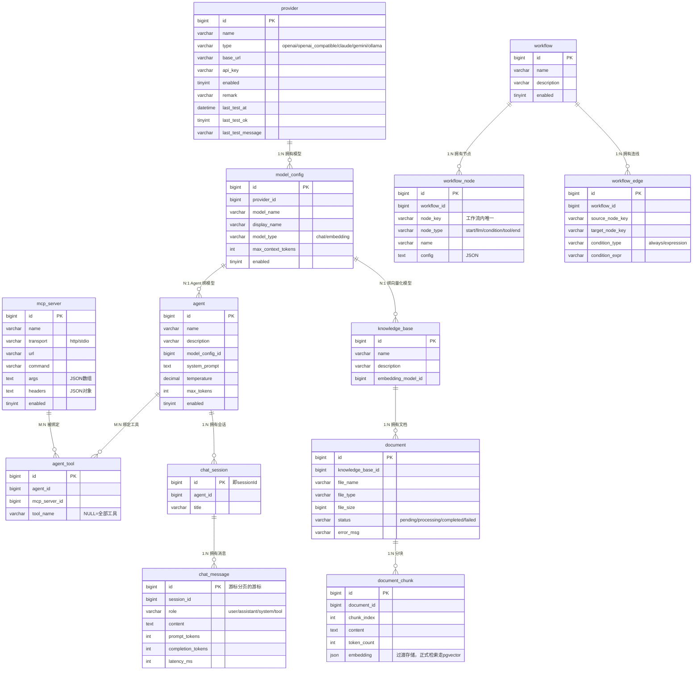

# Hify 数据模型（ER 图）

对应建表脚本：`hify-app/src/main/resources/db/schema.sql`（MySQL 8.x，utf8mb4，无数据库级外键，关系在应用层维护）。

统一约定：主键 `id` bigint 自增；`created_at` / `updated_at` datetime 自动维护；
`deleted` tinyint 逻辑删除（0=正常 1=删除）；所有实体继承 `hify-common` 的 `BaseEntity`，业务实体只声明自己的字段。

## 关系图

## 表结构明细

### provider — 模型提供商

| 字段 | 类型 | 说明 |
|---|---|---|
| id | bigint PK | 自增 |
| name | varchar(64) | 提供商名称，如 OpenAI |
| type | varchar(32) | openai / openai_compatible / claude / gemini / ollama |
| base_url | varchar(255) | API 地址（含版本前缀，如 https://api.openai.com/v1），空串=官方默认 |
| api_key | varchar(512) | 密钥（响应只回掩码；多凭证类型将来存 JSON） |
| enabled | tinyint | 0=停用 1=启用 |
| remark | varchar(255) | 备注 |
| last_test_at | datetime | 最近一次连通性测试时间，NULL=从未测试 |
| last_test_ok | tinyint | 最近一次测试结果：0=失败 1=成功，NULL=从未测试 |
| last_test_message | varchar(255) | 最近一次测试信息（失败原因等） |

索引：`idx_provider_type (type)`

### model_config — 模型配置

| 字段 | 类型 | 说明 |
|---|---|---|
| id | bigint PK | 自增 |
| provider_id | bigint | 所属 provider.id |
| model_name | varchar(64) | 模型标识，如 gpt-4o |
| display_name | varchar(64) | 展示名称 |
| model_type | varchar(16) | chat（对话）/ embedding（向量化），知识库向量化复用本表 |
| max_context_tokens | int | 上下文窗口上限，0=未知/不限 |
| enabled | tinyint | 0=停用 1=启用 |

索引：`idx_model_config_provider_id (provider_id)`

### mcp_server — MCP 工具服务

| 字段 | 类型 | 说明 |
|---|---|---|
| id | bigint PK | 自增 |
| name | varchar(64) | 服务名称 |
| description | varchar(255) | 服务描述 |
| transport | varchar(16) | http（含 SSE / Streamable HTTP）/ stdio |
| url | varchar(255) | HTTP 接入地址 |
| command | varchar(255) | stdio 启动命令 |
| args | text | stdio 参数，JSON 数组 |
| headers | text | HTTP 请求头，JSON 对象 |
| enabled | tinyint | 0=停用 1=启用 |

### agent — Agent 配置

| 字段 | 类型 | 说明 |
|---|---|---|
| id | bigint PK | 自增 |
| name | varchar(64) | Agent 名称 |
| description | varchar(255) | 描述 |
| model_config_id | bigint | 绑定模型 model_config.id |
| system_prompt | text | System Prompt |
| temperature | decimal(3,2) | 采样温度 0.00-2.00 |
| max_tokens | int | 单次回复上限，0=模型默认 |
| enabled | tinyint | 0=停用 1=启用 |

索引：`idx_agent_model_config_id (model_config_id)`

### agent_tool — Agent 与 MCP 工具绑定（M:N）

| 字段 | 类型 | 说明 |
|---|---|---|
| id | bigint PK | 自增 |
| agent_id | bigint | agent.id |
| mcp_server_id | bigint | mcp_server.id |
| tool_name | varchar(128) | 具体工具名；NULL=绑定该服务全部工具 |

索引：`idx_agent_tool_agent_id`、`idx_agent_tool_mcp_server_id`

### chat_session — 对话会话

| 字段 | 类型 | 说明 |
|---|---|---|
| id | bigint PK | 即 sessionId，对应 Redis 上下文 key `session:{id}` |
| agent_id | bigint | 关联 agent.id |
| title | varchar(128) | 会话标题 |

索引：`idx_chat_session_agent_id (agent_id)`

不做用户/权限体系，会话归属暂不落库，需要时再加 `created_by`。

### chat_message — 对话消息（增长最快的表）

| 字段 | 类型 | 说明 |
|---|---|---|
| id | bigint PK | 自增，游标分页的游标 |
| session_id | bigint | 所属 chat_session.id |
| role | varchar(16) | user / assistant / system / tool |
| content | text | 消息内容 |
| prompt_tokens | int | 输入 token 数 |
| completion_tokens | int | 输出 token 数 |
| latency_ms | int | LLM 响应耗时（毫秒） |

索引：`idx_chat_message_session_id (session_id, id)`——游标分页直接走此索引，避免 `SELECT COUNT(*)`。

### workflow / workflow_node / workflow_edge — 工作流

workflow：name、description、enabled。

workflow_node：

| 字段 | 类型 | 说明 |
|---|---|---|
| id | bigint PK | 自增 |
| workflow_id | bigint | 所属 workflow.id |
| node_key | varchar(64) | 节点标识，工作流内唯一，连线按此引用（应用层校验唯一性） |
| node_type | varchar(32) | start / llm / condition / tool / end |
| name | varchar(64) | 节点名称 |
| config | text | 节点配置 JSON：LLM 节点含 model_config_id 与 prompt 模板等 |

workflow_edge：

| 字段 | 类型 | 说明 |
|---|---|---|
| id | bigint PK | 自增 |
| workflow_id | bigint | 所属 workflow.id |
| source_node_key / target_node_key | varchar(64) | 起终点节点 |
| condition_type | varchar(16) | always（无条件）/ expression（条件满足） |
| condition_expr | varchar(512) | 条件表达式，如 `${node1.output} == "yes"` |

索引：`idx_workflow_node_workflow_id`、`idx_workflow_edge_workflow_id`

### knowledge_base / document / document_chunk — 知识库

knowledge_base：name、description、embedding_model_id（指向 model_config，model_type=embedding）。

document：

| 字段 | 类型 | 说明 |
|---|---|---|
| id | bigint PK | 自增 |
| knowledge_base_id | bigint | 所属 knowledge_base.id |
| file_name | varchar(255) | 文件名 |
| file_type | varchar(32) | pdf / txt / md / docx |
| file_size | bigint | 字节数 |
| status | varchar(16) | pending → processing → completed / failed |
| error_msg | varchar(512) | 失败原因 |

document_chunk：

| 字段 | 类型 | 说明 |
|---|---|---|
| id | bigint PK | 自增 |
| document_id | bigint | 所属 document.id |
| chunk_index | int | 块序号，从 0 开始 |
| content | text | 分块文本 |
| token_count | int | 分块 token 数 |
| embedding | json | 向量**过渡存储**：MySQL 无向量类型，正式向量检索由 pgvector 承接（knowledge 模块落地时引入 PG，届时本列迁移或废弃） |

索引：`idx_document_knowledge_base_id`、`idx_document_chunk_document_id`
